<p align="center">
  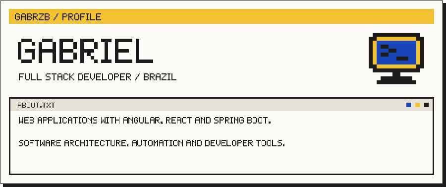
</p>

<p></p>

<p><strong>Languages</strong></p>
<p>
  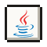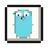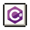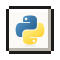
</p>

<p><strong>Frontend</strong></p>
<p>
  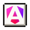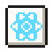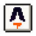
</p>

<p><strong>Backend</strong></p>
<p>
  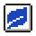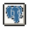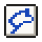
</p>

<p><strong>DevOps</strong></p>
<p>
  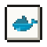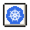
</p>

<p>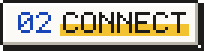</p>

<p>
  <a href="./Resume.pdf"></a
  ><a href="https://www.linkedin.com/in/gabriel-zaniqueli/"></a
  ><a href="https://github.com/gabrzb"></a
  ><a href="mailto:contatozaniqueli@gmail.com"></a>
</p>

<br>

```text
 gabrzb@github ~ % exit
 logout
 Saving session...completed.

 [Process completed]▌
```
