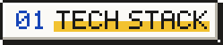
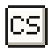
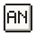
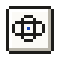
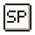
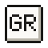
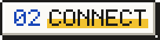

```text
                                       .--------------------.
                                       | .----------------. |
   ____       _          _      _      | | >_ hello       | |
  / ___| __ _| |__  _ __(_) ___| |     | |    world       | |
 | |  _ / _` | '_ \| '__| |/ _ \ |     | |                | |
 | |_| | (_| | |_) | |  | |  __/ |     | '----------------' |
  \____|\__,_|_.__/|_|  |_|\___|_|     '----------.---------'
                                            _____|_|_____
                                           /_____________\

 .----------------------------------------------------------------------.
 | (x) (-) (+)                 ~/about.txt                              |
 |----------------------------------------------------------------------|
 |                                                                      |
 | Gabriel Zaniqueli Beltrame / Full Stack Developer / Brazil           |
 | Shipping code since 2019. Building web applications since 2021.      |
 |                                                                      |
 | Responsive UIs with Angular and React. REST APIs with Spring Boot.   |
 | Currently building with Angular/React + Spring Boot + Docker.        |
 |                                                                      |
 | Interested in software architecture, automation and developer tools. |
 | My goal: deliver applications that solve real problems at scale.     |
 |                                                                      |
 | Open to collaboration, freelance projects and new opportunities.     |
 | -@gabrzb                                                             |
 |                                                                      |
 '----------------------------------------------------------------------'
```

<p></p>

<p><strong>Languages</strong></p>
<p>
  
</p>

<p><strong>Frontend</strong></p>
<p>
  
</p>

<p><strong>Backend</strong></p>
<p>
  
</p>

<p><strong>DevOps</strong></p>
<p>
  
</p>

<p></p>

<p>
  <a href="./Resume.pdf"></a
  ><a href="https://www.linkedin.com/in/gabriel-zaniqueli/"></a
  ><a href="https://github.com/gabrzb"></a
  ><a href="mailto:contatozaniqueli@gmail.com"></a>
</p>

<br>

```text
 gabrzb@github ~ % exit
 logout
 Saving session...completed.

 [Process completed]▌
```
